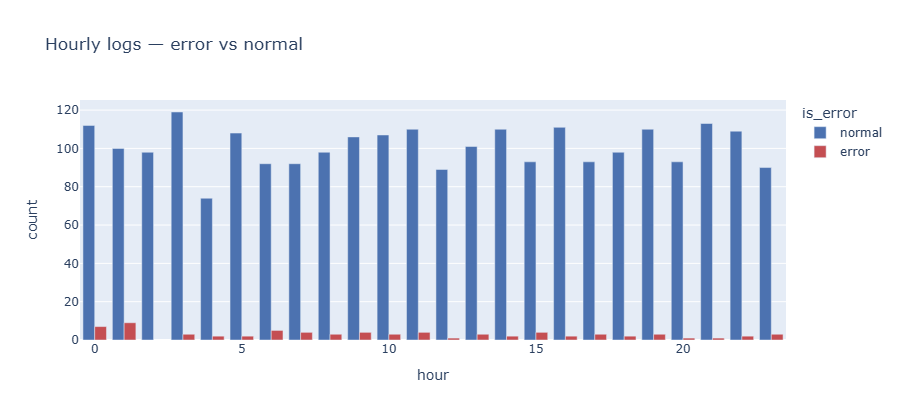

# 모두마켓 웹 접속 로그 — EDA & 시각화 보고서

## 1. 데이터 개요
- 행/열: (2502행, 7열)
- 주요 컬럼: log_id, session_id, response_time_ms, request_path, device, hour, is_error

## 2. 결측 진단 (missingno)
- `response_time_ms` 결측 비율: 4.8 %
- 결측 패턴: 새벽 시간대(2~4시) 로그에 결측이 집중됨
- 의심 가설: 심야 시간대 측정 모듈 점검으로 측정값 누락 등

## 3. 정제와 검증 (전·후 분포 비교)
- 적용한 정제: 중복 제거 / device 표기 통일 / hour 이상치 / response_time_ms 결측 대체 / 극단치 클리핑
- KDE 비교 결과: 분포의 범위(0~400ms)와 전체 모양은 정제 전과 거의 같아 본질이 유지되었으나, 정제 후 중앙값(약 180ms) 부근에 봉우리가 뾰족해졌다. 이는 결측을 중앙값으로 대체하면서 같은 값이 몰린 영향으로 보인다.
- device distinct: 5 → 2 (정상)

## 4. 탐색에서 도출한 새 질문
- 새벽 시간대 특히 자정 직후부터 3시전까지 에러 응답 비율이 높은데 서버 점검 시간인가
- `/checkout` 응답 시간이 다른 경로보다 길다 — 결제 단계 최적화 후보인지 다른 원인이 있는지 파악
- 새벽 4시에 정상 로그만 유독 적은(약 74건) 이유는 로그 수집 누락인가
- /category와 /cart에만 위쪽 이상치 점이 찍히는 이유는 무엇인가
- /checkout의 응답시간의 편차가 다른 것들에 비해 큰 이유가 무엇인가

## 5. 전달용 차트 1개 (이미지 또는 코드 인용)

## 6. 다음 분석 제안
- (예) 에러 응답 원인 추적 / 시간대 세분화 분석 / 디바이스별 성능 비교
- 시간대별 에러율 분석 — 에러 개수가 아닌 비율로 다시 집계해, 0~1시 에러 집중이 실제 위험 신호인지 확인
- 경로 × 상태 교차 분석 — 에러가 어느 경로에서 주로 나는지, 에러가 몰리는 시간대에 특정 경로의 응답 시간도 함께 늘어나는지 본다.
4. /checkout 응답 시간 편차 분석 — 시간대·기기별로 쪼개 원인 후보 좁히기