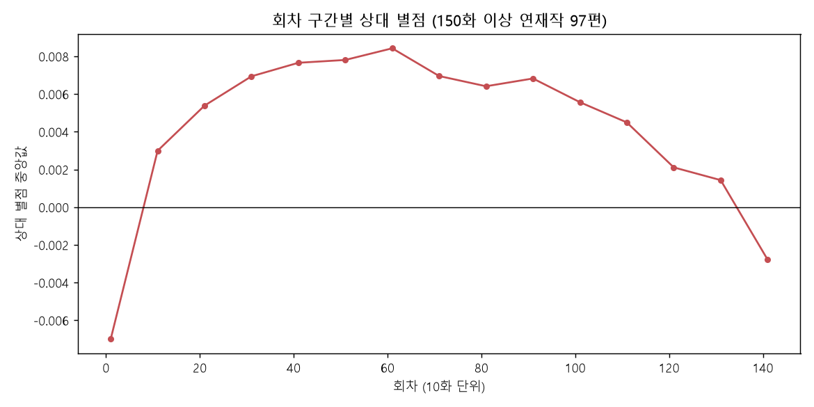

# 네이버 웹툰 인기순 vs 조회순 EDA 보고서

## 1. 개요

| 항목 | 내용 |
|---|---|
| 주제 | 네이버 웹툰 인기순·조회순 순위의 관계와 순위를 설명하는 요인 |
| 데이터 출처 | 네이버 웹툰 요일별 목록·작품 정보·회차 목록 API (https://comic.naver.com/webtoon) |
| 수집일 | 2026-10-29 |
| 규모 | 요일별 연재작 846편 (중복 제외 820편), 회차 65,265개 |

- robots.txt 금지 경로(`/webtoon/detail` 등)는 사용하지 않고 `/api/...` 경로만 사용, 요청 간 0.15초 대기
- 조회수는 API에서 대부분 0으로 가려져 있어(846편 중 16편만 공개) **순위 기반 상관계수**로 분석
- 요일마다 작품 수가 달라(116~136편) 순위를 **0~1 백분위**로 정규화 (0 = 1위)

---

## 2. 분석 결과

### 2-1. 인기순과 조회순은 거의 같은 순서

| 요일 | 월 | 화 | 수 | 목 | 금 | 토 | 일 | **전체** |
|---|---|---|---|---|---|---|---|---|
| Spearman ρ | 0.952 | 0.934 | 0.943 | 0.969 | 0.943 | 0.901 | 0.943 | **0.940** |

- 모든 요일 ρ ≥ 0.90. 상위 10위는 보통 10편 중 8편이 겹침
- 순위 구간별로는 **중위권(20~50%)에서 가장 많이 엇갈림** (ρ 0.68, 상위 20%는 0.84)

### 2-2. 두 순위가 갈리는 원인은 연재 기간

| 작품 | 인기순 | 조회순 | 특징 |
|---|---|---|---|
| 아사 (토) | 136 | 43 | 장기 연재 |
| 몽홀 (금) | 85 | 5 | 휴재 중 |
| 끓는 점 (화) | 48 | 100 | 신작 |
| 메이드 (토) | 42 | 83 | 신작 |

- 작품 등록 순서(titleId)와 순위차의 상관 ρ = 0.42 (p ≈ 3e-38)
- 신작 64편은 인기순이 평균 **+10.6%p**, 휴재작 44편은 조회순이 평균 **+8.4%p** 더 높음
- → **조회순은 누적 조회수, 인기순은 최근 반응**을 반영하는 것으로 추정

### 2-3. 순위를 설명하는 것은 별점이 아니라 관심 등록 수

| 지표 | vs 인기순 | vs 조회순 |
|---|---|---|
| 작품 별점 | 0.163 | 0.235 |
| **관심 등록 수** | **0.677** | **0.798** |

- 별점은 작품의 61%가 중앙값 9.9점 이상이라 차이를 담지 못함 (천장 효과)

### 2-4. 여러 요일 연재작은 토요일에 순위가 더 높음

- 여러 요일에 동시 연재되는 25편은 작품이 같고 요일만 달라서, 요일에 따른 순위 차이를 직접 비교할 수 있음
- 토요일에도 연재되는 **9편 모두** 토요일 순위가 평소보다 높음 (−3.2 ~ −9.2%p, 평균 −5.2%p, 윌콕슨 p = 0.004)
- 단 25편 중 14편이 일상툰이라, 일상툰에 한정된 현상일 수 있음

### 2-5. 장편 웹툰의 '100화 고비'

- 150화 이상 연재작 97편, 무료 회차의 상대 별점(회차 별점 − 작품 중앙값) 기준
- **1~10화 최저 → 40~100화 정점 → 110화 이후 하락**

| 비교 (작품 단위) | 해당 작품 비율 | p값 |
|---|---|---|
| 중반(41~100화) > 초반(1~10화) | 79% | 2.4e-07 |
| 후반(111~150화) < 중반 | 77% | 1.5e-06 |

- 패턴은 확실하지만 크기는 약 0.015점으로 작음 (회차 별점 사분위 폭 0.10점의 15%)

---

## 3. 결론

1. 인기순과 조회순은 매우 강하게 일치 (ρ = 0.94), 중위권에서 가장 많이 엇갈림
2. 차이의 원인은 연재 기간: 신작은 인기순, 오래된·휴재작은 조회순이 더 높음
3. 순위를 가장 잘 설명하는 지표는 별점이 아닌 관심 등록 수
4. 여러 요일 연재작은 토요일에 순위가 더 높음
5. 장편 웹툰 별점은 40~100화에 정점, 110화 이후 하락

---

## 4. 한계점

- **하루치 스냅샷**: 시간에 따른 순위 변화와 인과 방향은 알 수 없음
- **정렬 기준 비공개**: '인기순 = 최근 반응'은 데이터 패턴으로 추정한 것
- **관심 수도 누적값**: 조회순과 성격이 겹치고 신작에 불리함
- **성인 작품 53편 제외**: 로그인이 필요해 회차 데이터를 수집하지 못함
- **작은 표본**: 토요일 효과는 9편 기준이라 일반화가 어려움
- **생존자 편향**: 완결·중단작이 빠져 수명 곡선은 살아남은 장편 위주

---

## 5. 후속 분석 제안

| 분석 | 방법 | 기대 결과 |
|---|---|---|
| 순위 시계열 | 매일 같은 시각 2~4주 수집 | '인기순 = 최근 반응' 직접 검증, 업로드 당일 효과 |
| 신작 생존 분석 | 시계열에서 상위 30% 진입까지 걸린 시간 (Kaplan-Meier) | 첫 주 순위로 장기 순위 예측 가능 여부 |
| 휴재의 비용 | 회차 공개일 간격으로 휴재를 찾아 전후 순위 비교 | 휴재 1회당 순위 하락 폭과 회복 기간 |
| 완결작 수명 곡선 | 완결작 전 회차 별점 수집 | 생존자 편향 없는 곡선 |

---

## 부록: 파일

| 파일 | 내용 |
|---|---|
| `analyze_rank_corr.ipynb` | 분석 노트북 (anaconda 커널) |
| `raw_user.json`, `raw_view.json` | 인기순·조회순 API 원본 |
| `cache/` | 작품별 관심 수·회차 별점 (삭제 시 재수집 약 1시간) |
| `webtoon_rank_merged.csv` | 두 순위 병합 데이터 |
| `rank_corr.png`, `lifecycle_curve.png` | 그래프 |
