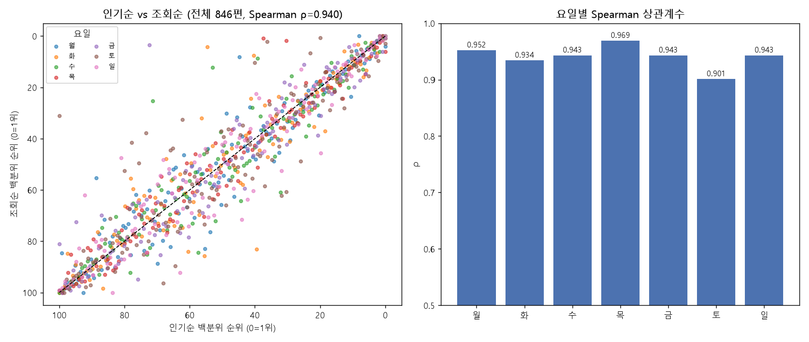

# 네이버 웹툰 인기순 vs 조회순 EDA 보고서

## 1. 개요

| 항목 | 내용 |
|---|---|
| 주제 | 네이버 웹툰 요일별 연재작의 '인기순' 순위와 '조회순' 순위의 상관관계 |
| 목적 | 두 정렬 기준이 얼마나 같은 순서를 보이는지, 다르다면 어떤 작품에서 왜 갈리는지 확인 |
| 데이터 출처 | 네이버 웹툰 요일별 웹툰 페이지<br>https://comic.naver.com/webtoon |
| 수집일 | 2026-10-29 |
| 분석 단위 | 요일별 연재 목록의 작품 1편 (여러 요일에 연재되는 작품은 요일마다 따로 집계) |

---

## 2. 데이터 수집

### 2-1. 수집 가능 여부 확인 (robots.txt)

```
User-agent: *
Allow: /

Disallow: /webtoon/list?*&page=
Disallow: /webtoon/detail
...
Disallow: /search
```

- 수집한 경로 `/api/webtoon/titlelist/weekday`는 금지 목록에 없어 **수집 허용** 경로임
- 학습 목적으로 작품명·순위·별점 등 텍스트·숫자 정보만 수집했고, 썸네일 이미지는 수집하지 않음
- 요청은 정렬 기준별 1회씩, 총 2회만 보냄

### 2-2. 사이트 구조

- 요일별 웹툰 화면은 JavaScript로 그려지는 페이지이지만, 내부적으로 아래 **JSON API**를 호출함
- 정렬 기준은 주소의 `order` 값만 바뀌므로 Selenium 없이 `curl`(또는 `requests`)로 바로 수집 가능

| 화면의 정렬 | API 주소 |
|---|---|
| 인기순 | `https://comic.naver.com/api/webtoon/titlelist/weekday?order=user` |
| 조회순 | `https://comic.naver.com/api/webtoon/titlelist/weekday?order=view` |

- 응답 구조: `titleListMap` 안에 `MONDAY` ~ `SUNDAY` 키별로 작품 리스트가 **정렬된 순서대로** 들어 있음
- 따라서 리스트 안에서의 위치(1, 2, 3, ...)가 곧 해당 요일의 순위

### 2-3. 수집 과정

1. 두 API 응답을 `raw_user.json`(인기순), `raw_view.json`(조회순)으로 저장
2. 요일별 리스트를 펼쳐 작품마다 순위 부여
3. `(요일, titleId)`를 키로 두 순위 표를 병합 → `webtoon_rank_merged.csv`
4. 요일마다 작품 수가 달라 순위를 **0~1 백분위**로 정규화해 요일 통합 분석에 사용 (0 = 1위)

> **주의:** 응답에 `viewCount`(조회수) 필드가 있지만 846편 중 16편만 값이 있고 나머지는 0으로 가려져 있음.
> 그래서 실제 조회수 대신 **순위 기반 상관계수(Spearman, Kendall)** 로 분석함.

---

## 3. 데이터 설명

### 3-1. 수집 결과

| 요일 | 월 | 화 | 수 | 목 | 금 | 토 | 일 | 합계 |
|---|---|---|---|---|---|---|---|---|
| 작품 수 | 124 | 120 | 116 | 116 | 117 | 136 | 117 | **846** |

- 인기순·조회순 목록의 작품 구성은 같아 846편 모두 짝지어짐 (결측 없음)

### 3-2. 변수

| 변수 | 설명 |
|---|---|
| `day` | 연재 요일 |
| `titleId` | 작품 고유 번호 (클수록 최근에 등록된 작품) |
| `titleName` | 작품명 |
| `starScore` | 별점 (10점 만점) |
| `rank_pop` | 해당 요일 인기순 순위 |
| `rank_view` | 해당 요일 조회순 순위 |
| `pct_pop`, `pct_view` | 요일 내 백분위 순위 (0 = 1위, 1 = 꼴찌) |
| `gap` | `rank_view - rank_pop` (+면 인기에 비해 조회순이 낮음, −면 조회순이 더 높음) |
| `new`, `rest` | 신작 여부, 휴재 여부 (원본 JSON 플래그) |

---

## 4. 분석 결과



### 4-1. 전체 상관관계

| 지표 | 값 |
|---|---|
| Spearman ρ | **0.940** (p ≈ 0) |
| Kendall τ | **0.808** |

- 점들이 대각선(두 순위가 같은 선)에 촘촘히 모여 있음 → **인기순과 조회순은 매우 강한 양의 상관**
- Kendall τ 0.808은 작품 두 편을 임의로 골랐을 때 약 90%의 확률로 두 기준의 앞뒤 순서가 같다는 뜻

### 4-2. 요일별 상관관계

| 요일 | 작품수 | Spearman | Kendall | Top10 겹침 | Top30 겹침 | 순위차 중앙값 |
|---|---|---|---|---|---|---|
| 월 | 124 | 0.952 | 0.825 | 8 | 29 | 5 |
| 화 | 120 | 0.934 | 0.804 | 6 | 26 | 4 |
| 수 | 116 | 0.943 | 0.823 | 8 | 25 | 4 |
| 목 | 116 | **0.969** | **0.864** | 8 | 27 | 4 |
| 금 | 117 | 0.943 | 0.826 | 8 | 25 | 5 |
| 토 | 136 | **0.901** | **0.754** | 5 | 26 | 7 |
| 일 | 117 | 0.943 | 0.810 | 8 | 25 | 5 |

- 모든 요일에서 ρ ≥ 0.90으로 결론은 같음
- **목요일**이 가장 일치, **토요일**이 가장 덜 일치 (작품 수가 가장 많고 상위 10위 겹침도 5편으로 최저)
- 상위 10위는 보통 10편 중 8편이 두 기준에 공통으로 들어감

### 4-3. 순위 구간별 일치도

| 인기순 구간 | 작품수 | Spearman | 백분위 차이 평균 |
|---|---|---|---|
| 상위 20% | 170 | 0.844 | 0.034 |
| 20~50% | 252 | **0.682** | 0.073 |
| 하위 50% | 424 | 0.807 | 0.074 |

- 상위권은 두 순위가 거의 같음 (평균 3.4%p 차이)
- **중위권(20~50%)** 에서 순서가 가장 많이 뒤섞임 → 비슷한 수준의 작품끼리 기준에 따라 자리가 바뀜

### 4-4. 두 순위가 크게 갈리는 작품

**조회순이 인기순보다 훨씬 높은 작품**

| 요일 | 작품명 | 인기순 | 조회순 | 차이 |
|---|---|---|---|---|
| 토 | 아사 | 136 | 43 | −93 |
| 금 | 몽홀 (휴재) | 85 | 5 | −80 |
| 화 | 윌유메리미 | 66 | 6 | −60 |
| 수 | 하렘의 남자들 | 83 | 30 | −53 |
| 토 | 멸망한 세계의 취사병 | 106 | 57 | −49 |

**인기순이 조회순보다 훨씬 높은 작품**

| 요일 | 작품명 | 인기순 | 조회순 | 차이 |
|---|---|---|---|---|
| 화 | 끓는 점 (신작) | 48 | 100 | +52 |
| 토 | 메이드 (신작) | 42 | 83 | +41 |
| 토 | 주식토피아 | 44 | 85 | +41 |
| 토 | 상향혼 컨설팅 | 93 | 131 | +38 |
| 화 | 시골 다방에 요괴들이 와요 | 67 | 103 | +36 |

### 4-5. 순위 차이의 원인: 연재 기간

위 작품들을 보면 오래된 작품은 조회순이, 신작은 인기순이 앞서는 패턴이 보여 수치로 확인함.

| 확인 항목 | 결과 |
|---|---|
| `titleId`(클수록 최신) vs 백분위 순위차 | Spearman ρ = **0.42** (p ≈ 3e-38) |
| 신작 64편의 평균 백분위 순위차 | **+10.6%p** (인기순이 더 높음) |
| 휴재작 44편의 평균 백분위 순위차 | **−8.4%p** (조회순이 더 높음) |
| 그 외 작품의 평균 백분위 순위차 | 약 0 |

- **조회순 ≈ 누적 조회수**: 오래 연재했거나 휴재 중인 작품은 최근 반응이 줄어도 쌓인 조회수로 상위 유지
- **인기순 ≈ 최근 반응**: 신작은 조회수가 아직 덜 쌓였지만 최근 반응이 좋아 인기순에서 먼저 올라옴

### 4-6. 별점과의 관계 (참고)

| 비교 | Spearman ρ |
|---|---|
| 별점 vs 인기순 | 0.163 |
| 별점 vs 조회순 | 0.235 |

- 상관이 약함. 별점이 대부분 9.8~9.9점대에 몰려 있어 작품 간 차이를 거의 설명하지 못함

---

## 5. 결론

1. 네이버 웹툰의 **인기순과 조회순은 매우 강하게 일치**함 (전체 ρ = 0.94, 모든 요일 ρ ≥ 0.90)
2. 상위권은 거의 같고, **중위권에서 순서가 가장 많이 엇갈림**
3. 두 순위가 갈리는 주된 이유는 **연재 기간**임
   - 오래된 작품·휴재작 → 조회순이 더 높음 (누적 효과)
   - 신작 → 인기순이 더 높음 (최근 반응)
4. 따라서 "지금 뜨는 작품"을 보려면 인기순, "오래 많이 읽힌 작품"을 보려면 조회순이 적합함
5. 별점은 두 순위와 거의 관계가 없어 작품 인기를 판단하는 지표로는 쓰기 어려움

---

## 6. 한계점

- **실제 조회수가 아닌 순위로만 분석**: API가 조회수를 숨겨 차이의 크기(몇 배 차이인지)는 알 수 없음
- **정렬 기준 비공개**: '인기순 = 최근 반응, 조회순 = 누적'은 데이터 패턴으로 추정한 것이며 네이버가 밝힌 기준이 아님
- **하루치 스냅샷**: 2026-10-29 하루 데이터만 사용해 시간에 따른 변화는 반영하지 못함
- **중복 집계**: 여러 요일에 연재되는 작품은 요일마다 따로 세어 전체 통계에 중복 포함됨
- **요일 연재작만 대상**: 완결작, 매일+, 베스트도전 등은 포함하지 않음

---

## 부록: 파일 목록

| 파일 | 내용 |
|---|---|
| `raw_user.json` | 인기순 API 원본 응답 |
| `raw_view.json` | 조회순 API 원본 응답 |
| `analyze_rank_corr.py` | 분석 스크립트 (`~/anaconda3/python`으로 실행) |
| `webtoon_rank_merged.csv` | 두 순위를 병합한 데이터 |
| `rank_corr.png` | 산점도 + 요일별 상관계수 차트 |
